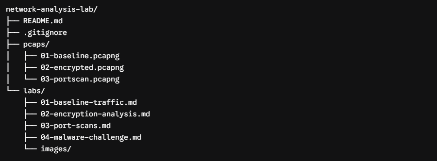

Built this small isolated virtual network lab to strengthen my fundamentals in basic networking especially looking at packets (which are confusing even now). Eventually, ill introduce and play around with suspicious and malicious behavior as well.

Setup is simple, just two VMs running inside a NAT network inside virtual box, nothing fancy.

| Device            | IP Address  | What it does                                           |
| ----------------- | ----------- | ------------------------------------------------------ |
| **Kali Linux**    | `10.0.2.15` | My analyst workstation (running Wireshark, curl, nmap) |
| **Ubuntu Server** | `10.0.2.5`  | The target server (SSH, web services, file transfers)  |

The planned structure for now is as follows, changes may occur as i go about it. But this is the initial plan:

